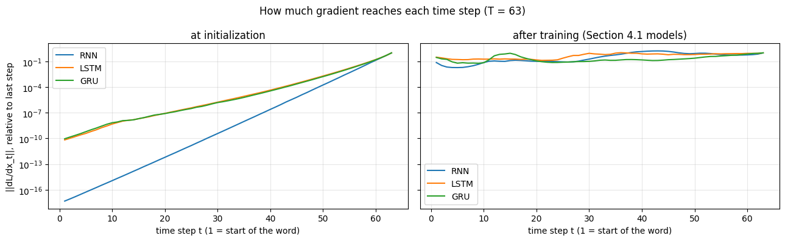

# Recurrent Neural Networks on Images and Audio

Midterm project (Topic 3) · Dhvani Patel · Instructor: Dr. Kokalj-Filipovic · Rowan University, Fall 2026

How does a recurrent network process sequential data, and how does the same architecture behave on two very different inputs? This project applies one PyTorch many-to-one recurrent classifier to:

- **CIFAR-10**, reading each 32×32 RGB image as 32 time steps of pixel rows (96 values per step), adapting the class RNN notebook, which reads MNIST digits row by row (96.5% test accuracy with a vanilla RNN).
- **Audio MNIST**, reading each spoken digit as 30–100 time steps of 40 MFCC features (10 ms frames), with a speaker-disjoint train / validation / test split.

## Results

| Task | Model | Test accuracy |
| --- | --- | --- |
| CIFAR-10 (rows as sequence) | LSTM, hidden 128 | 56.0% |
| Audio MNIST (unseen speakers) | vanilla RNN, hidden 128 | 83.6% |
| Audio MNIST (unseen speakers) | LSTM, hidden 128 | 98.3% |
| Audio MNIST (unseen speakers) | GRU, hidden 128 | 99.2% |

The notebook also compares LSTM hidden sizes 32–256 and measures how much gradient reaches each time step (vanishing gradients) before and after training.

## Contents

| Path | Description |
| --- | --- |
| `rnn_cifar10_audiomnist.ipynb` | All code, with outputs from the final run |
| `figures/` | Plots produced by the notebook (curves, confusion matrices, gradient profiles) |
| `requirements.txt` | Python packages (all pre-installed on Google Colab) |

## How to run

1. Open `rnn_cifar10_audiomnist.ipynb` in [Google Colab](https://colab.research.google.com/) (File → Open notebook → GitHub, or upload the file).
2. Select a GPU runtime: Runtime → Change runtime type → T4 GPU.
3. Run all cells in order (Runtime → Run all) and allow access to Google Drive when asked.

Datasets, cached features, figures and trained models are saved to `MyDrive/rnn_midterm` on Google Drive, so later sessions skip the downloads. The first run downloads CIFAR-10 (170 MB) and clones Audio MNIST (about 1 GB), then extracts MFCC features, so it is much slower than later runs.

Outside Colab, the notebook writes to `~/rnn_midterm` instead (or to the folder in the `PROJECT_DIR` environment variable).

## Data

- CIFAR-10: Krizhevsky (2009), downloaded through `torchvision.datasets.CIFAR10`.
- Audio MNIST: Becker et al., [github.com/soerenab/AudioMNIST](https://github.com/soerenab/AudioMNIST), 30,000 recordings from 60 speakers.
